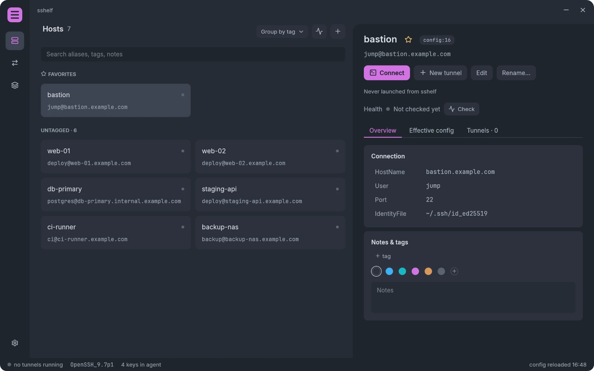
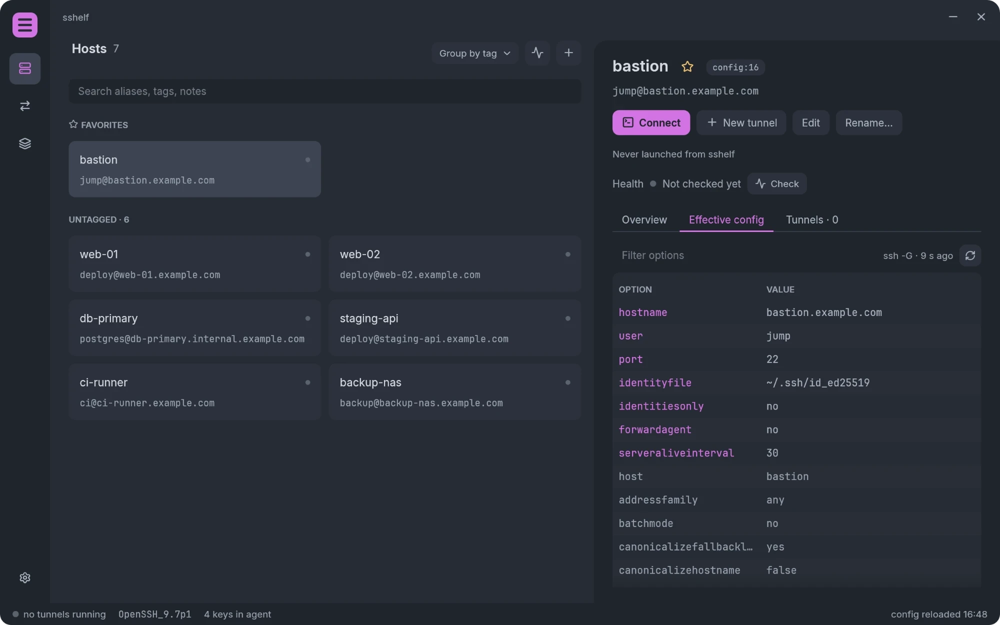
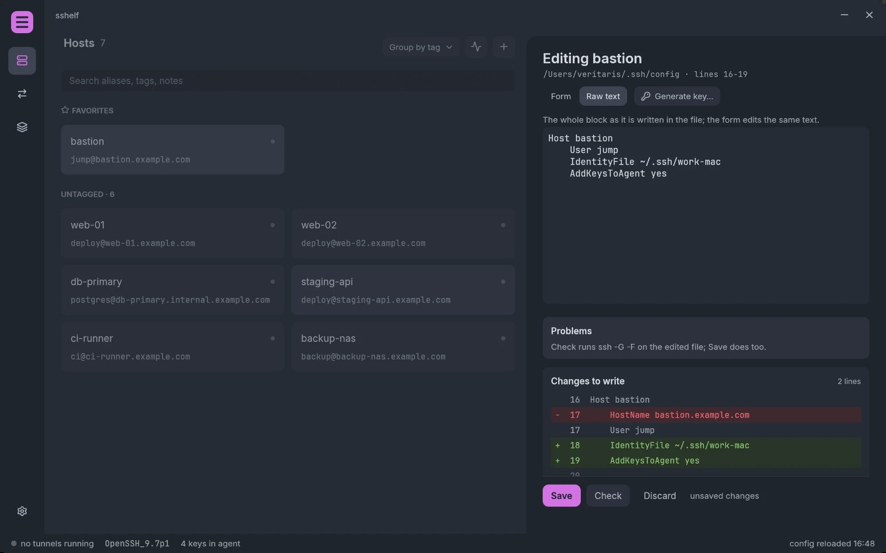
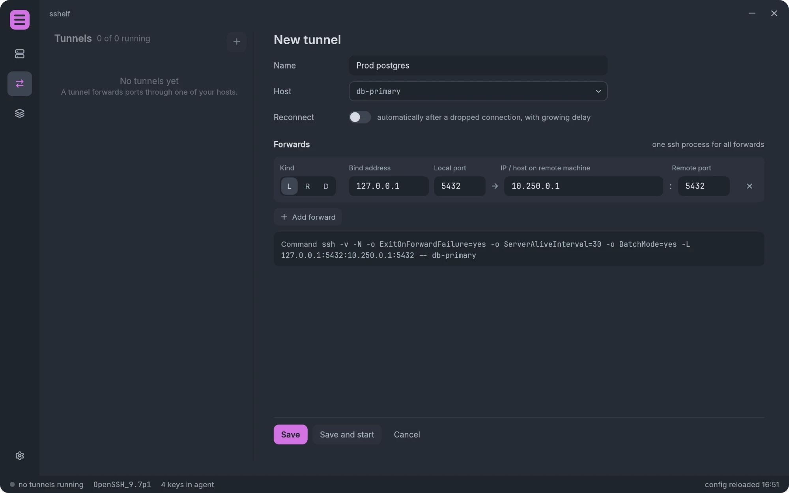
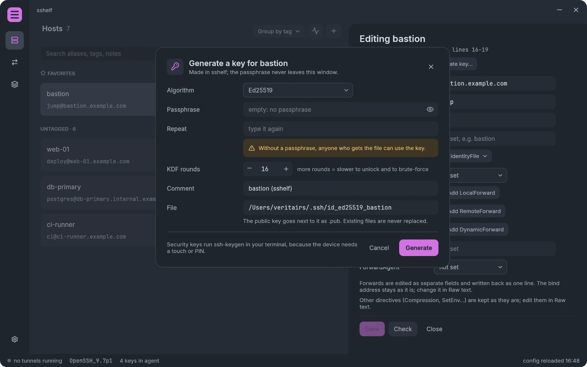
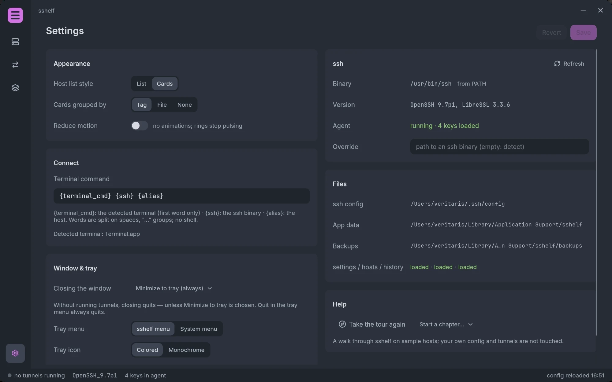

# sshelf

> **How this project is made:** sshelf follows spec-driven development (SDD). I write and maintain the specification ([SPEC.md](SPEC.md)), and most of the code is written by an LLM (Claude Opus) with a human in the loop: I make the design decisions, review the changes and test each milestone.

A desktop app for Windows, macOS and Linux that puts a visual layer over your real `~/.ssh/config`. Browse your hosts, see what ssh will actually do for each of them, edit them safely, open sessions, and keep port-forwarding tunnels running from one place.



## Who it's for

People who live in `~/.ssh/config`: developers and ops engineers with dozens of hosts, jump hosts, and database or admin tunnels they start every morning. If you like your config file as it is, and want a better view of it rather than an SSH client with its own host database, sshelf is for you.

It also helps the people around you: a newcomer can see what a host resolves to, start the team's tunnels with a switch, and get a plain-language explanation when a key isn't accepted, without learning every `ssh` flag first.

## What it promises

- **Your ssh config stays the source of truth.** sshelf reads it, and writes only when you save an edit. Lines you didn't change are written back byte for byte: comments, spacing, line endings, order and directives it doesn't know. Every file is backed up before its first change in a session, and you see the diff before saving.
- **It uses your own `ssh`.** Connections, tunnels and the effective config all come from the system `ssh` binary (`ssh -G`), so `ProxyJump`, `ProxyCommand`, `Include`, `Match` and your agent work exactly as on the command line.
- **It never reads your private keys and never stores passwords or passphrases.**
- **It never accepts a host key for you.** Unknown and changed host keys are shown with their fingerprints, and nothing is stored until you confirm.

## Features

**Hosts**
- Every host from your config and its `Include`s, as a list or cards (grouped by tag or file), with search, tags, notes, colours and favorites.
- The **effective config** of a host as `ssh -G` reports it, with a filter.
- The route through jump hosts ("you › bastion › db-gw › web").
- **Health checks** on request: a single non-interactive login that tells you why a host fails (no key accepted, unknown or changed host key, unreachable) and offers the fix.
- **Connect** opens your terminal with `ssh <host>` (Windows Terminal, Terminal.app, or the usual Linux terminals; the command is configurable).



**Editing**
- A form for the common directives and the raw text of the block, editing the same text.
- `ssh -G -F` checks the result before it's saved, and the change preview shows exactly which lines are written.
- New hosts, renames (tunnels and notes follow the new alias), and conflict handling when the file changed on disk meanwhile.



**Tunnels and groups**
- Local (`-L`), remote (`-R`) and dynamic (`-D`) forwards, several per tunnel, in one `ssh` process.
- Start and stop tunnels one by one, or as **groups** (e.g. "work on prod"); a group can start with sshelf.
- Live state, logs, the reason a tunnel failed with a hint, and optional automatic reconnect.
- Tunnels keep running with the window closed: sshelf stays in the tray or menu bar, with a status dot and a menu to switch groups and connect.



**Host keys**
- Before a tunnel or a connect, the keys of every host on the way are checked without connecting; an unknown one is shown with its fingerprint and stored only when you accept it.
- A changed key shows the stored and presented fingerprints side by side and is replaced only after you type the host's name.

**Keys**
- Generate a key for a host (Ed25519, ECDSA, RSA, or a hardware security key through `ssh-keygen`), with an optional passphrase that never leaves the window.
- Install the public key on the server and load it into your agent.



**And**
- A short onboarding **tour** on sample hosts, with a fake ssh, so nothing touches your config or servers.
- Light on the eyes: a One Dark theme, and *Reduce motion* for no animations.



## Install

Download the package for your system from the [releases](https://github.com/Veritaris/sshelf/releases):

- **Windows:** the `.7z` holds `sshelf.exe`. It uses the OpenSSH that ships with Windows (`C:\Windows\System32\OpenSSH`).
- **macOS:** open the `.dmg` and drag `sshelf.app` to Applications. The app isn't signed with a Developer ID yet, so the first start needs right click › *Open* (or `xattr -d com.apple.quarantine /Applications/sshelf.app`).
- **Linux:** the `.tar.gz` holds the `sshelf` binary and, under `share/`, a desktop entry and icon laid out like `~/.local/share`. Put `sshelf` on your `PATH` and install them for your user, so launchers and docks show it with its icon:

  ```
  cp -r share/. ~/.local/share/
  ```

  The tray needs a StatusNotifier host (KDE, most desktops; GNOME with the AppIndicator extension).

## Getting started

1. Start sshelf. The first launch offers a **tour** of about six minutes on sample hosts, or goes straight to your own config. The tour can be repeated any time from *Settings › Help*.
2. Pick a host to see its connection details and effective config; *Check* tells you whether it's reachable and your key is accepted.
3. *Connect* opens a terminal; *Edit* changes the host (review the diff, then *Save*).
4. Under **Tunnels**, *New tunnel* forwards ports through a host; *Save and start* runs it. Group tunnels you use together under **Groups** and switch them on and off with one click, also from the tray.
5. Closing the window with tunnels running asks what to do; *Minimize to tray* keeps them running.

sshelf keeps its own data (tags, notes, tunnels, groups, settings and backups) in versioned TOML files in its app folder, linked to your hosts by alias:

| System | App folder |
|---|---|
| Windows | `%APPDATA%\sshelf` |
| macOS | `~/Library/Application Support/sshelf` |
| Linux | `~/.config/sshelf` |

## Build from source

Requires stable Rust (edition 2024).

```
cargo run -p sshelf
cargo test --workspace
```

On Linux, install the windowing dev packages first (Debian/Ubuntu):

```
sudo apt-get install libxcb-render0-dev libxcb-shape0-dev libxcb-xfixes0-dev libxkbcommon-dev
```

The design, the scope and the milestones are in [SPEC.md](SPEC.md). Built with Rust and egui/eframe.

## License

MIT, see [LICENSE](LICENSE).
